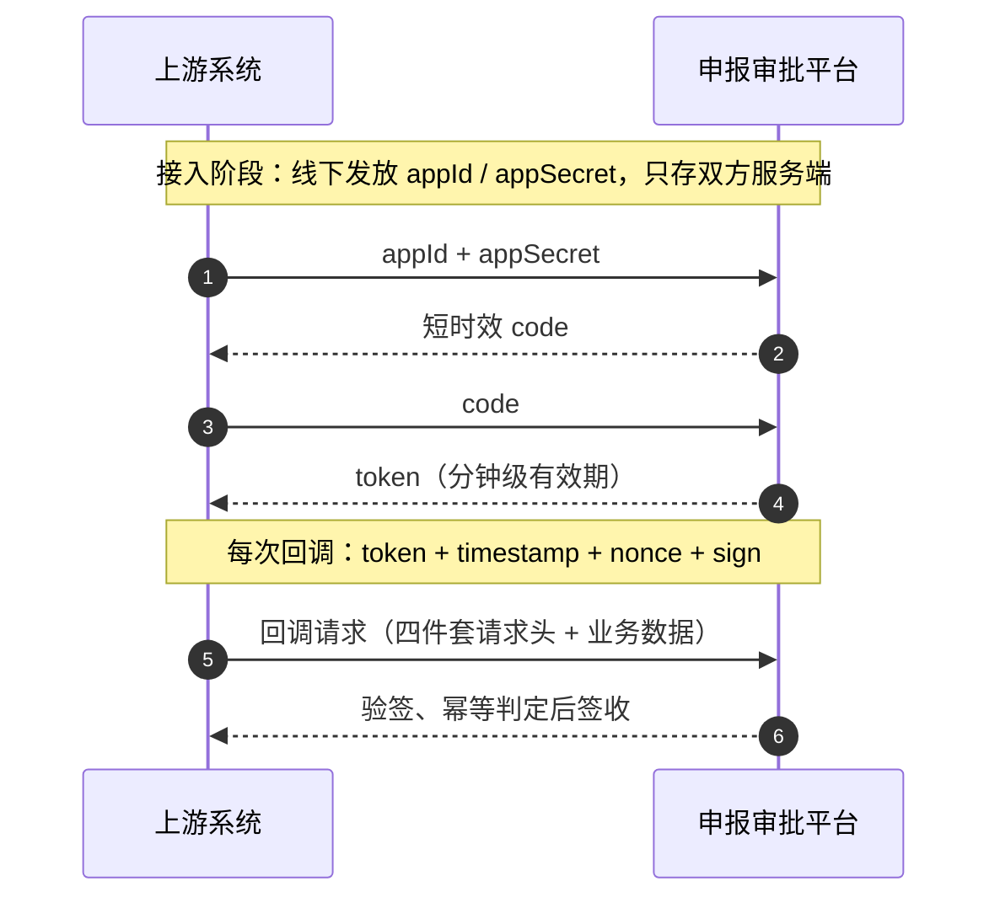

## 场景

审批状态机管的是“内部怎么走”，这篇管“外面怎么进来”：审批结果在上游系统产生，要推给我们。接收方是我负责的申报模块，一共五个回调接口，覆盖受理结果、查验结果、报送反馈、文件下载这几类事件，上游每推进一步，就有一个回调落到我们系统上。

这类接口的麻烦在于调用方是外部系统，两条内网假设全部失效：不能信网络（包可以被截获、重放），也不能信请求本身（任何人都能朝这个地址发请求）。所以回调接口要先回答三个问题：你是谁、这个请求是不是刚发生的、内容有没有被改过。鉴权链、防重放、签名分别回答这三问，幂等则处理“哪怕前三问都过了，请求还是会重复”的现实。

## 鉴权链：appId / appSecret → code → token

最省事的做法是发一个长期 token，请求头带上就完事。我们没用长期 token，原因很实际：token 会泄露。它放在对方系统里，日志可能打印、代码可能硬编码、运维可能贴到群里；而两个系统之间换密钥要走流程、要约时间窗口，泄露之后的吊销成本比想象中大。

所以拆成三段。接入时发一对 appId / appSecret，appSecret 只存在于双方服务端配置里，永远不上网络；调用前对方先拿 appId 加 appSecret 换一个短时效 code；再用 code 换 token，token 有效期只有分钟级，过期就重新走一遍。

这样每次实际调用的凭证只有几分钟寿命，泄露窗口被压到最小；真正需要保密的 appSecret 不参与日常请求。代价是对方每次会话多一次换码往返，放在服务端对服务端的调用里，这点开销可以忽略。



## 防重放与防篡改：四个请求头

token 只证明“调用方是我授权过的”，不证明“这个请求是刚发出的”。抓包的人拿一个合法请求原样重发，token 校验照样通过。所以每个回调请求还要带四个头：timestamp、nonce、sign，外加 token 本身。

- **timestamp**：请求发起时间。服务端拒绝与当前时间偏差超过 5 分钟的请求，挡住几天前的老包
- **nonce**：一次性随机串。服务端把见过的 nonce 记下来，重复出现直接拒绝，挡住时间窗口内的重放
- **sign**：签名。把请求参数和 timestamp、nonce 按约定顺序拼接，用 appSecret 计算 HMAC；服务端同样算一遍再比对，挡住篡改——参数改了，签名就对不上

四件套缺一不可：只看 timestamp，攻击者改个时间戳就行；只靠 nonce，内容可以被改；只有签名没有时间约束，一个旧请求可以永远重放。合在一起，攻击者要么完整伪造（需要 appSecret，拿不到），要么原样重放（被 timestamp 或 nonce 拦住）。

验签收敛在拦截器里做，业务代码不感知：

```java
// 回调签名校验拦截器（简化）
public boolean preHandle(HttpServletRequest req) {
    if (expired(req.getHeader("timestamp"), 5, ChronoUnit.MINUTES)) {
        return false;                                   // 老请求
    }
    if (!redis.tryAcquireNonce(req.getHeader("nonce"), 5, ChronoUnit.MINUTES)) {
        return false;                                   // 窗口内重放
    }
    String expected = hmacSha256(secret, canonicalString(req));
    return constantTimeEquals(expected, req.getHeader("sign"));
}
```

两个实现细节值得写下来。一是拼接顺序要写成文档交给对方，参与签名的字段列表也要固定：我们约定“参数名按字典序排序、值不做 URL encode、空值不参与”，这条规则在双方各自实现时最容易走样。二是比对签名用常量时间比较，至少别用会短路的 `==`——这个场景被计时攻击打穿的实际门槛很高，但写对也不费事。

## 幂等：假设回调一定会重复

前三关都过了，还有一个现实：上游的重试策略不归我们管。网络抖动它重发，超时判断保守它重发，上游升级后的补推更是成批地来。回调必须默认会重复、会乱序、会迟到。

幂等键是申报单 id 加状态版本。上游推送的结果里带着它针对的状态版本号，我们本地每次状态迁移也维护自己的版本（状态迁移走带版本号的乐观锁更新，版本不匹配直接失败）。判断放在状态迁移的同一个事务里：

- 回调版本大于本地版本：合法迁移，执行并落流水
- 回调版本小于等于本地版本：这个结果已经处理过，或者被人工操作超越了——签收、返回成功、丢弃

返回成功很重要。上游收到成功就不再重试；返回失败只会让它加倍重推，制造更多需要幂等掉的流量。而“同事务”是底线：版本判断和状态更新必须在同一个数据库事务里，拆开就重新有了并发窗口，等于白做。

乱序的处理也是这一个判断顺带完成的：后到的旧版本自然落进“小于等于”分支，我不需要为乱序单独设计什么。

## 踩坑

**验签“随机”失败。** 联调初期验签时好时坏，最后发现是 URL encode：对方框架对参数值做了 encode，我们按原始值计算签名。错得“随机”，是因为只有参数里恰好出现需要编码的字符（中文、空格、加号）时才会失败。排查半天，结论现在写在接入文档第一行：参与签名的值一律用原始值。

**nonce 的存储成本。** 每个请求存一个 nonce，TTL 5 分钟，量大之后就是纯粹的内存税。按我们的回调量级算过，5 分钟窗口内的占用可以忽略，直接 `SET NX PX` 最简单。如果量大到这笔税肉疼，更合理的方向是按时间分桶、整桶过期，而不是缩短 TTL——缩短窗口等于放宽重放。这个优化我没有做，量没到。

## 效果

这套设计随二期上线，五个回调接口没有出过安全事件。上游某次升级后的批量补推（同一批结果重发了几遍）被幂等层安静地吃掉了，业务方没有感知。安全设计做对的标准之一，就是它工作时没人注意到它。
